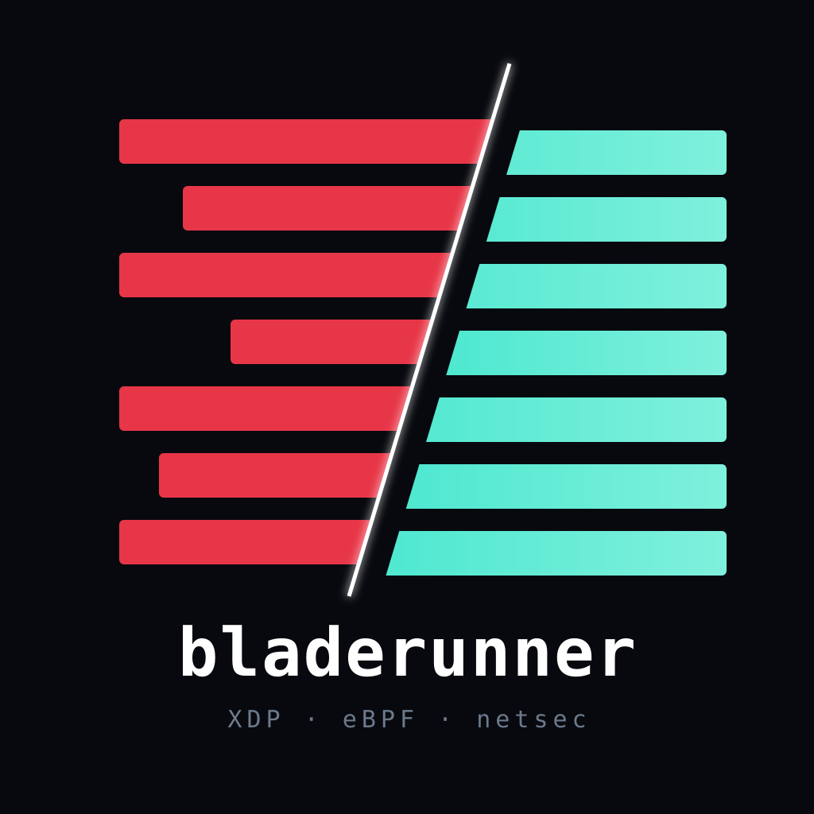

<p align="center">
  
</p>

# 🛡️ bladerunner

[](https://github.com/ishworgurung/bladerunner/actions/workflows/ci.yml)
[](https://github.com/ishworgurung/bladerunner/actions/workflows/build.yml)
[](LICENSE)


XDP/eBPF DDoS mitigation for a Linux host or edge box. A packet filter in the
driver's receive path (`bpf/bladerunner.bpf.c`) plus a Go control plane that
watches sampled traffic, detects attacks, and pushes fingerprint rules and
source blocks into BPF maps at runtime. The CLI is `bladerunner`.

> [!WARNING]
> **Experimental.** bladerunner is early-stage software. It has only been
> tested in generic (SKB) XDP mode on virtual machines, not on production
> traffic or native-driver hardware. Run it in dry-run mode first, and see
> [docs/STATUS.md](docs/STATUS.md) for what is tested and what is not.

| Layer | What it does |
|-------|--------------|
| Static lists | Allowlist (always wins), blocklist (LPM trie, IPv4 + IPv6), TTL entries expire **in-kernel** |
| Hygiene | Amplification source-port table with min-length, fragment drop, invalid TCP flags, port 0 |
| Rate limiting | Per-source token buckets for SYN / UDP / DNS / ICMP (IPv6 per /64), two limit sets |
| Adaptive | EWMA baseline of offered load; on attack, tighter limits are switched on atomically |
| Fingerprints | Sampled packets (1-in-N) are aggregated into signatures; new ones become DROP rules, known ones a shared rate limit |
| Heavy hitters | A source above a rate for N windows gets a TTL block |
| Safety | Dry-run (default), allowlist first, ND/ARP/non-IP untouched, fail-open, rules expire without the daemon |
| Shared lists | Optional: allow and block CIDR ranges from Redis, mirrored into the kernel maps; Redis down means last known lists stay (fail-open) |
| Ops | `bladerunner` CLI over pinned maps, Prometheus `/metrics`, SIGHUP reload |

## 🚀 Quick start

```sh
# Debian/Ubuntu
sudo apt install clang libbpf-dev linux-libc-dev golang
make deps          # go mod tidy (fetches modules, writes go.sum)
make build         # compiles the BPF object, embeds it, builds ./bladerunner
make test          # unit + kernel tests (verifier load, BPF_PROG_TEST_RUN)
make e2e           # 30s loopback smoke test in generic mode

cp configs/bladerunner.yaml my.yaml   # edit interface, protected, allowlist
sudo ./bladerunner run -c my.yaml              # starts in DRY-RUN
sudo ./bladerunner status                      # see what WOULD be dropped
sudo ./bladerunner dryrun off                  # enforce
```

🔑 Put your management and upstream addresses in `allowlist` before turning
dry-run off.

```
bladerunner block 198.51.100.0/24 --ttl 1h     bladerunner list block
bladerunner allow 192.0.2.10                   bladerunner rules
bladerunner dryrun on|off                      bladerunner stats
bladerunner detach                             # after a --persist run
```

## ⚠️ Honest scope

* ⚙️ **Native vs offload.** `mode: native` is driver XDP (the program runs in the
  NIC driver on the host CPU). True NIC *offload* (nfp SmartNICs) is not
  supported by this prototype: the program uses features offload does not.
  `generic` mode works anywhere but runs after the skb is allocated and is
  slow; use it for labs only.
* 📉 **Scale.** This is a single-host filter. It will not save a link that is
  saturated upstream. Terabit floods have to be handled by your upstream or a
  scrubbing provider; bladerunner is the layer that keeps the host's own CPU
  and conntrack out of the blast.
* 🎯 **Rate limiting is approximate.** Token buckets are updated without
  cross-CPU atomics. Expect error of a few percent under heavy multi-queue load.
* 🔍 **Fingerprinting can false-positive.** A new, legitimate traffic pattern
  that suddenly exceeds `min_tuple_pps` during an attack looks the same as
  attack traffic. That is why it only acts in attack mode, only on signatures
  absent from the baseline, expires after `rule_ttl`, and starts in dry-run.
* 🎭 **Spoofed sources.** Heavy-hitter blocking attributes by source address.
  With spoofed sources you may block innocent addresses (TTL-bounded).
  Prefer fingerprints for spoofed floods.
* IPv6: only the Fragment extension header is parsed; other extension headers
  are treated as an opaque next-header.

## 🗂️ Layout

```
bpf/               XDP program + shared header
cmd/bladerunner/            daemon and CLI
internal/bpf/      loader, typed map access, kernel tests
internal/detect/   attack detector, fingerprinting, heavy hitters (pure Go)
internal/engine/   control loop
internal/config/   YAML config
internal/metrics/  Prometheus text exposition
scripts/e2e_lo.sh  loopback end-to-end test
docs/              ARCHITECTURE.md, OPERATIONS.md, STATUS.md (tested / TODO)
```

## ✅ Status

Verified on Linux 6.18 / clang 18: the program passes the verifier,
`BPF_PROG_TEST_RUN` tests cover every verdict path, and the loopback e2e runs
detection → rule install → block in XDP generic mode. **Not yet verified:** 🧪
native mode on physical NICs (driver-specific), multi-queue throughput
numbers, kernels older than ~5.15.

## 📄 License

[MIT](LICENSE). The embedded eBPF object declares the kernel license string
`"Dual BSD/GPL"` only so the kernel will load it; that string is not the
license of this source. Bundled dependencies are listed in
[THIRD_PARTY_NOTICES](THIRD_PARTY_NOTICES).
