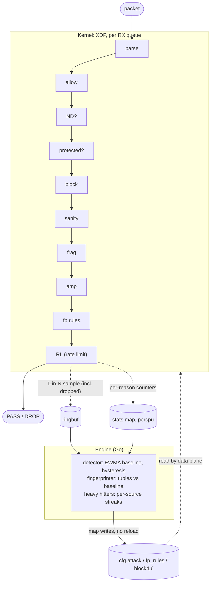

# 🏗️ Architecture

## 🔢 Verdict order

First match wins; every packet is counted under exactly one reason.

1. Parse (Ethernet, 2×VLAN, IPv4/IPv6, TCP/UDP/ICMP). Non-IP → pass. Truncated → drop.
2. Source in **allow** → pass.
3. IPv6 ND with hop-limit 255 → pass (link-local control traffic).
4. `protected_only` and destination not protected → pass untouched.
5. Source in **block** (and not expired) → drop.
6. Sanity: NULL, SYN+FIN, SYN+RST, port 0.
7. Fragments (if enabled).
8. UDP source port in **amp_ports** with length ≥ min.
9. **Fingerprint rules** (≤32, scanned linearly): DROP, or shared token bucket.
10. **Per-source token bucket** by class; limits chosen by `cfg.attack`.

Dry-run changes only the final return value; counters and samples are identical.

## 🧠 Design choices

* **Sampling sees dropped traffic.** The sample records the verdict reason, so
  the control plane keeps seeing an attack it is already mitigating. Traffic
  already blocked by the blocklist is excluded from fingerprinting.
* **Detection uses offered load** (all reasons summed), not what passed, so
  mitigation cannot mask the attack and cause flapping.
* **The baseline is frozen under attack**, so the attack cannot teach the
  system that it is normal.
* **Fail-safe expiry.** Block entries and fingerprint rules carry
  `expires_ns` (CLOCK_MONOTONIC) checked in the data plane. If the daemon
  dies, mitigations age out instead of lingering.
* **Rule updates are not atomic as a set.** Rules are written first and
  `fp_n` last; a packet may briefly see a mix of old and new rules.
* **Verifier friendliness.** The only loop is the 32-iteration rule scan with
  a constant bound; all map indices are masked or bounds-checked.
* **Struct layout** is shared via `bpf/bladerunner_common.h`; `TestLayout` checks the
  Go mirrors against the kernel's map key/value sizes.

## 📏 Limits

| Resource | Size |
|---|---|
| Blocklist | 262,144 IPv4 + 65,536 IPv6 prefixes |
| Rate-limit state | 262,144 IPv4 + 131,072 IPv6 (source, class) buckets, LRU |
| Fingerprint rules | 32 |
| Amp ports | 256 |
| Sample ring buffer | 4 MiB |
