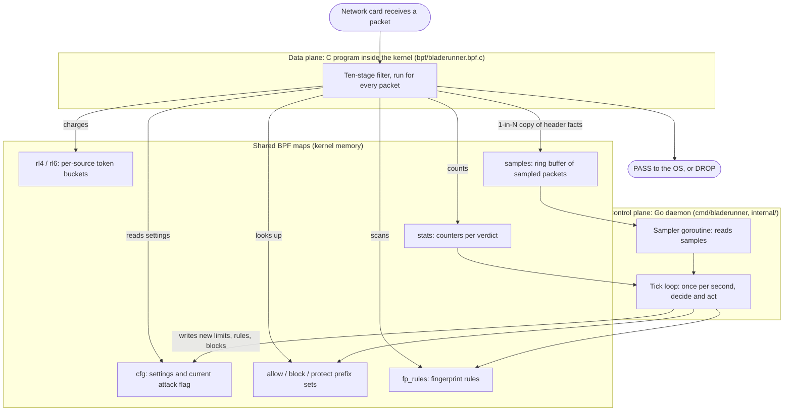
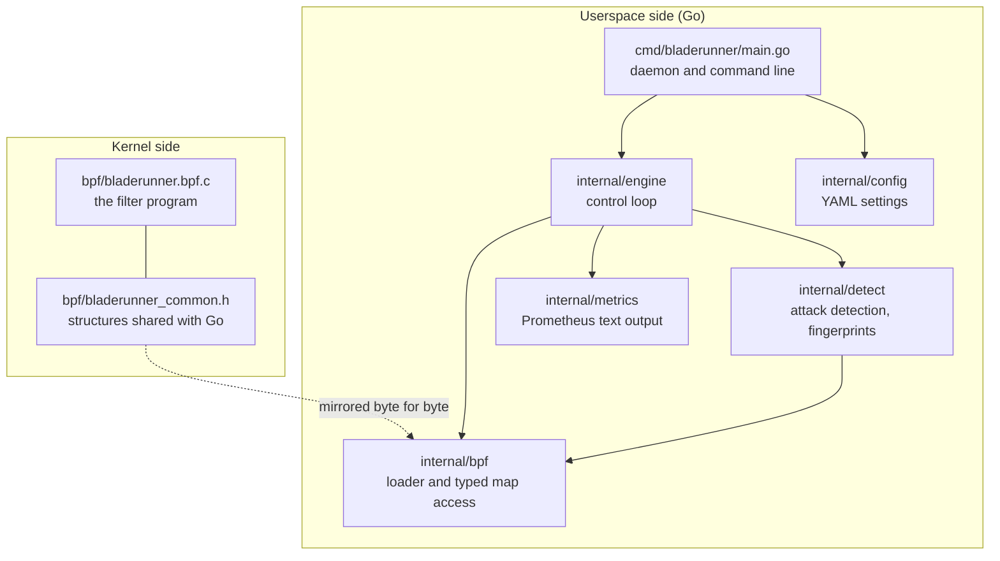
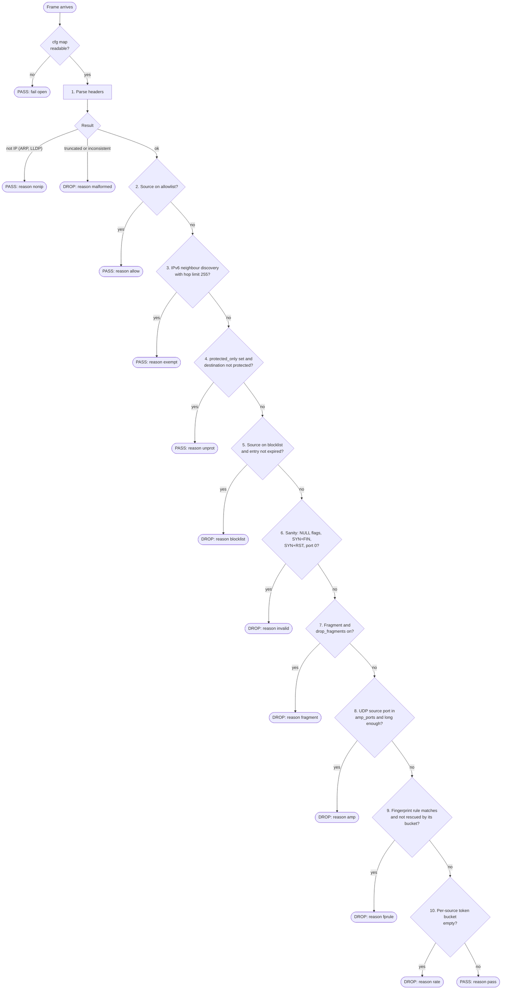
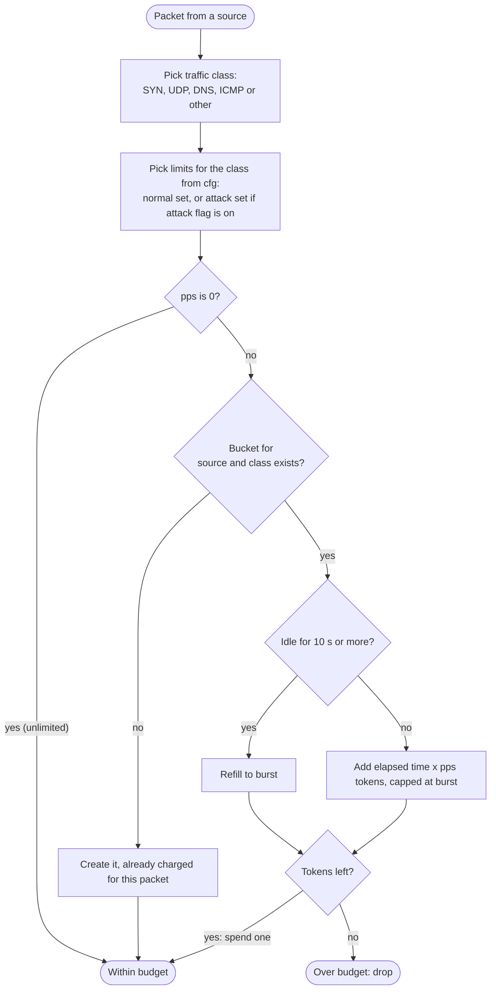
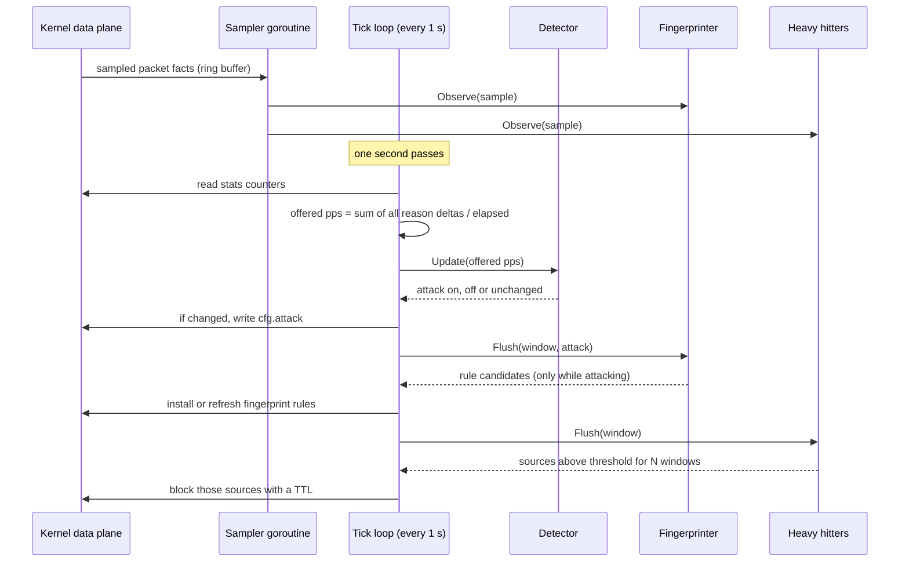
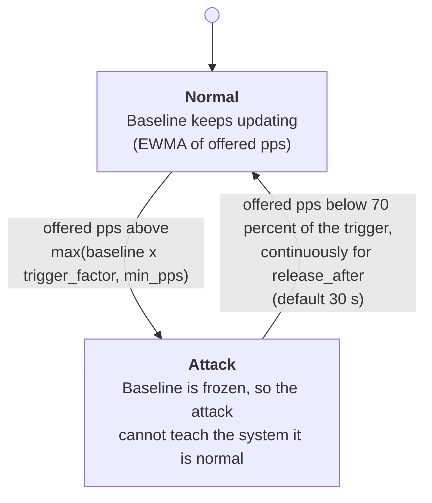
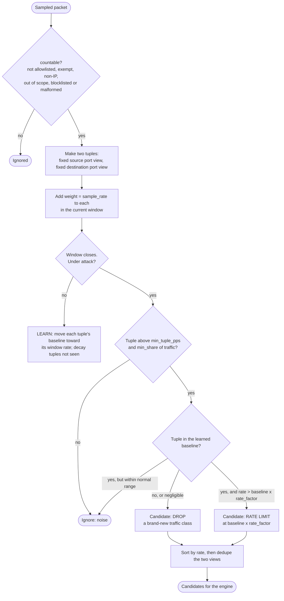
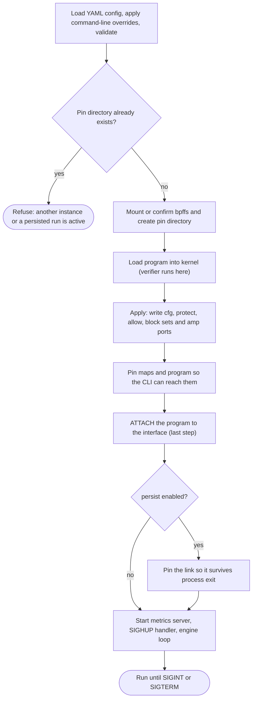
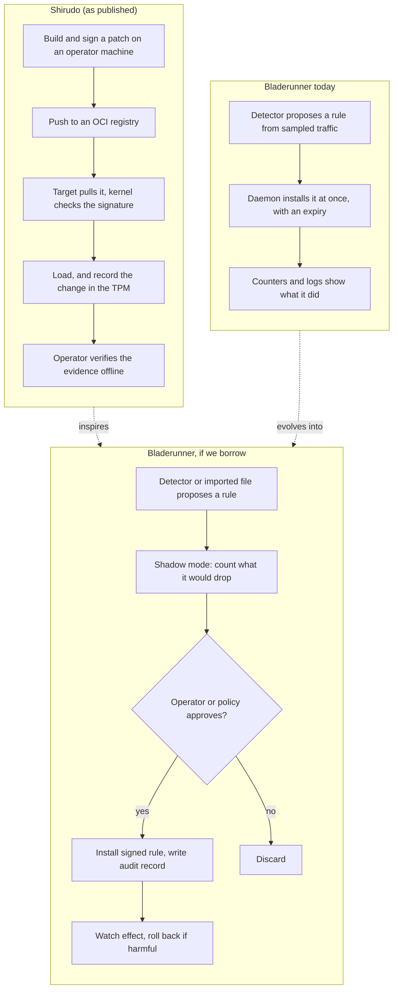

# 🧭 Bladerunner Design

This document explains how bladerunner works and why it is built the way it is.
It is written for someone reading the code for the first time. Terms and
acronyms are explained where they first appear. For short reference material,
see [ARCHITECTURE.md](ARCHITECTURE.md) (verdict order and limits) and
[OPERATIONS.md](OPERATIONS.md) (running it in production).

## 1. 🎯 What problem this solves

A **DDoS** (Distributed Denial of Service) attack tries to knock a server
offline by sending it far more traffic than it can handle, usually from many
machines at once. The cheapest place to stop that traffic is as early as
possible, before the operating system has spent any real effort on it.

Bladerunner is a packet filter that sits at the very first point where a
Linux machine sees a packet. It has two jobs:

1. **Filter fast.** Drop obviously bad traffic, and rate-limit everything
   else, at the speed of the network card.
2. **Adapt.** Notice when an attack is under way, work out what the attack
   looks like, and tighten the filter automatically, without anyone typing
   a command.

It protects a single host or edge router. It does not scrub traffic in the
cloud, and it does not read packet contents (more on that in
[section 11](#11--limits-and-honest-trade-offs)).

## 2. 🧱 The big picture: a fast kernel half and a smart userspace half

The design splits the work in two, because the two jobs have opposite needs.

* Filtering must be extremely fast and must run for every single packet. That
  work lives **inside the Linux kernel**, in a small program called the *data
  plane*.
* Working out "is this an attack, and what does it look like?" needs memory,
  history and maps with millions of entries. That work lives in an ordinary
  Go program called the *control plane*, which looks at a small sample of the
  traffic and then changes the data plane's settings.

The two halves never call each other. They communicate only through shared
tables in kernel memory, called **BPF maps**.

Three consequences of this split shape everything else:

* **The kernel never waits for userspace.** If the daemon is slow, busy, or
  crashes, packets keep being filtered with the last settings it wrote.
* **Settings change without reloading the program.** The daemon edits map
  contents; the next packet sees the new values.
* **The kernel part is small and bounded.** The kernel refuses to run code it
  cannot prove is safe, so the data plane is deliberately simple (see
  [section 4](#4--how-the-kernel-accepts-our-program)).

## 3. 🧰 The technologies, briefly

* **eBPF** (extended Berkeley Packet Filter) is a Linux feature that lets you
  load small, checked programs into the kernel. They run at defined hook
  points and can read and write shared tables (maps) but cannot crash the
  kernel.
* **XDP** (eXpress Data Path) is one such hook point: the program runs the
  moment a packet arrives from the **NIC** (Network Interface Card), before
  the kernel allocates its normal per-packet bookkeeping. Returning `XDP_DROP`
  throws the packet away almost for free; `XDP_PASS` hands it on normally.
* **Native versus generic mode.** In *native* mode the program runs inside the
  NIC driver, which is fastest but needs driver support. In *generic* mode it
  runs a little later and works on any interface, including loopback, but is
  slower. Attaching is done in [`Attach`](../internal/bpf/loader.go#L155).
* **Go with the cilium/ebpf library** loads the compiled program, creates the
  maps and reads and writes them. The compiled kernel object is embedded in
  the Go binary ([loader.go:20](../internal/bpf/loader.go#L20)), so shipping
  bladerunner means shipping one file.

### Where the code lives

The shared header [bladerunner_common.h](../bpf/bladerunner_common.h) is the contract between
the two halves. Every structure there has an identical twin in
[types.go](../internal/bpf/types.go). The test `TestLayout` in
[bpf_test.go](../internal/bpf/bpf_test.go) compares the Go sizes with the
sizes the kernel reports for each map, so a mismatch fails the build instead
of silently corrupting data.

## 4. 🔒 How the kernel accepts our program

Before the kernel runs any eBPF program, a component called the **verifier**
reads every possible path through it and proves that it cannot read outside
the packet, loop forever, or touch invalid memory. This shapes the code in
four visible ways.

1. **Bounds checks everywhere.** Every read from packet memory is preceded by
   a comparison against the packet's end pointer, for example
   [bladerunner.bpf.c:236](../bpf/bladerunner.bpf.c#L236). That comparison is
   what lets the verifier prove the read is safe.
2. **Loops have constant bounds.** The only real loop is the fingerprint-rule
   scan, capped by `BLADERUNNER_MAX_FP_RULES` (32)
   ([bladerunner_common.h:28](../bpf/bladerunner_common.h#L28)).
3. **Indexes are masked.** For example `idx &= 0xFF` in
   [`stat_inc`](../bpf/bladerunner.bpf.c#L336), so the verifier can bound the
   array index.
4. **No vendored kernel headers.** The program uses only stable public kernel
   headers, because it only reads standard packet formats and has nothing
   kernel-version-specific to adapt to.

### A real lesson: the verifier complexity blow-up

The verifier gives up after examining one million instructions. An earlier
version passed on one kernel and was rejected on another with "BPF program is
too large". The cause was the rule-matching code being inlined into the
32-iteration loop: each early `return 0` in it created a new path for the
verifier to explore, and the paths multiplied across iterations.

The fix is [`fp_match`](../bpf/bladerunner.bpf.c#L449), deliberately written as
a separate, non-inlined function. The verifier checks such a function once on
its own and, at each call, treats the result as an unknown yes or no. The
regression test [`TestVerifierComplexity`](../internal/bpf/complexity_test.go)
loads the program with statistics turned on and fails if the verifier needed
more than 100,000 instructions, a tenth of the hard limit, so other kernels
that prune differently still have headroom.

## 5. 📬 The data plane: what happens to one packet

The entry point is [`bladerunner_xdp`](../bpf/bladerunner.bpf.c#L593). It runs once per
received frame and walks through ten stages. **The first stage that has an
opinion decides the packet's fate and the rest are skipped.** Every packet is
counted under exactly one reason, which matters later because the detector
adds all the counters together to learn the total load.

A few notes on why the order is what it is. The allowlist comes first so that
nothing can ever lock out your own management traffic. Neighbour discovery
(ND, the IPv6 equivalent of ARP) is exempted next, because dropping it would
disconnect the host from its own network. Scope (stage 4) comes before any
dropping stage so that traffic you did not ask bladerunner to protect is never
touched. The cheap, exact checks (stages 5 to 8) run before the more
expensive, stateful ones (stages 9 and 10).

### Stage 1: parsing

[`parse`](../bpf/bladerunner.bpf.c#L227) turns raw bytes into a small struct
called `pkt` ([bladerunner.bpf.c:172](../bpf/bladerunner.bpf.c#L172)) holding
addresses, ports, length, **TTL** (Time To Live, the hop counter on an IP
packet), protocol and TCP flags. Everything the later stages need is extracted
once, so only this function touches packet memory and only here does the
verifier's bounds-checking burden live.

It understands Ethernet, up to two **VLAN** (Virtual LAN) tags including the
double-tagged **QinQ** form, IPv4, IPv6, and the transport headers for **TCP**
(Transmission Control Protocol), **UDP** (User Datagram Protocol) and
**ICMP** (Internet Control Message Protocol). Two subtleties are handled
explicitly:

* **Fragments.** A large IP packet can be split into fragments, and only the
  first one carries the transport header. If the parser tried to read ports
  from a later fragment it would be reading payload bytes as if they were a
  header. So later fragments stop after the IP header, with ports set to zero
  ([bladerunner.bpf.c:288](../bpf/bladerunner.bpf.c#L288)).
* **IPv4 header length.** The **IHL** (Internet Header Length) field says how
  long the header is. Impossible values, or a header that runs past the end
  of the packet, mark the packet malformed
  ([bladerunner.bpf.c:269](../bpf/bladerunner.bpf.c#L269)).

### Stages 2 to 8: exact-match checks

The allow, block and protect sets are **LPM** (Longest Prefix Match) tries,
the kernel's structure for "is this address inside any stored network?". A
lookup with a full-length key returns the most specific stored prefix that
covers it, so `192.0.2.0/24` and a single `192.0.2.7/32` can coexist. Each
entry can carry an **expiry time inside the kernel**, checked on every lookup
by [`live`](../bpf/bladerunner.bpf.c#L350). A temporary block therefore stops
working the instant it expires, even if the daemon is dead and never cleans
up. That is a deliberate fail-safe.

Stage 6 drops combinations of TCP flags that no real implementation sends but
crafted floods often do. Stage 8 targets **reflection and amplification**
attacks: an attacker sends small requests to public servers (NTP, DNS,
memcached and similar) with the victim's address forged as the sender, and the
servers send large replies to the victim. Those replies all come *from* a
well-known source port, so the table `amp_ports` maps a port to a minimum
packet size above which to drop. Small replies from the same port still pass,
so a legitimate small answer is not collateral damage.

### Stage 9: fingerprint rules

A fingerprint rule ([`struct bladerunner_fp_rule`](../bpf/bladerunner_common.h#L164)) is a
conjunction of range checks: protocol, address family, source-port range,
destination-port range, length range, TTL range and a TCP flags mask. A rule
either drops everything it matches, or applies one *shared* token bucket to
all matching packets so the class is throttled as a whole. These rules are not
written by hand in normal operation; the control plane generates them while an
attack is happening ([section 7](#7--the-control-plane-learning-and-reacting)).

Rule matching is done by [`fp_match`](../bpf/bladerunner.bpf.c#L449). Wildcards
need no special code: a wildcard is simply the widest range, 0 to 65535 for a
port. A later fragment has port zero, which only a full-range wildcard
matches.

### Stage 10: per-source rate limiting with token buckets

Each source address gets a small budget, modelled as a **token bucket**. The
bucket holds up to `burst` tokens and refills at `pps` (packets per second).
Each packet spends one token. When the bucket is empty, packets are dropped
until time has refilled it. This allows short bursts while enforcing a
long-run average rate.

The implementation is [`take_token`](../bpf/bladerunner.bpf.c#L396) and
[`source_ok`](../bpf/bladerunner.bpf.c#L498). Several details are worth
knowing.

* **Classes.** A source has a separate bucket for each class (SYN, UDP, DNS,
  ICMP, other), chosen by [`rate_class`](../bpf/bladerunner.bpf.c#L478). A
  host flooding UDP therefore cannot use up its own budget for ordinary TCP.
  A **SYN** is the first packet of a TCP connection, and SYN floods are a
  classic attack, so SYNs get the tightest budget.
* **Two limit sets.** The configuration holds a *normal* and an *attack* set.
  Entering attack mode flips a single number (`cfg.attack`), and every source
  instantly uses the tighter set. No per-source state needs rewriting.
* **IPv6 per /64.** An IPv6 customer normally owns a whole `/64` network, so
  limiting individual addresses would be pointless. Buckets are keyed on the
  first 64 bits ([bladerunner.bpf.c:524](../bpf/bladerunner.bpf.c#L524)).
* **Bounded memory.** The bucket tables are **LRU** (Least Recently Used)
  hash maps. When full, the oldest entry is evicted to make room. A flood of
  spoofed source addresses therefore cannot exhaust the table or stop new
  sources being tracked.
* **Fractional refill.** The timestamp only advances when at least one whole
  token was added, so at low rates the fractions accumulate instead of being
  rounded away.
* **Approximate by design.** Several CPUs can touch one bucket at the same
  time without locks. The occasional lost update makes the limiter slightly
  loose, which is far better than the cost of locking at line rate.

### Counting, sampling and dry-run

Every path ends in [`finish`](../bpf/bladerunner.bpf.c#L577), the single exit
point. It does three things in order: increments the counter for the reason,
maybe copies a sample for userspace, and then turns the reason into `PASS` or
`DROP`. Reasons from `blocklist` onward are the dropping ones
([bladerunner_common.h:46](../bpf/bladerunner_common.h#L46)).

**Dry-run mode** suppresses only that last step. Counters and samples are
identical, so you can run for days, read the counters and see exactly what
*would* be dropped, then switch enforcement on.

**Counters are per-CPU.** The stats map keeps one copy per processor, so the
hot path adds to its own CPU's copy with no atomic operations and no cache
contention. The daemon sums the copies when it reads.

**Sampling** ([`emit_sample`](../bpf/bladerunner.bpf.c#L542)) copies roughly
one packet in `sample_rate` into a **ring buffer**, a lock-free queue shared
with userspace. Only header facts are copied
([`struct bladerunner_sample`](../bpf/bladerunner_common.h#L224)), never payload. Three choices
matter here:

* Dropped packets are sampled too, with the verdict recorded. Otherwise once a
  rule starts working, the daemon would stop seeing the attack and conclude it
  was over.
* If the buffer is full the sample is thrown away and counted
  (`bladerunner_samples_lost_total`). The data plane never waits.
* A ring buffer was chosen over per-CPU perf buffers because one shared
  buffer preserves ordering and wastes no per-CPU memory.

## 6. 🗺️ The maps, in one place

| Map | Kind | Purpose |
|---|---|---|
| `cfg` | array, 1 entry | Flags, sample rate, rule count, attack flag, normal and attack limits |
| `stats` | per-CPU array | Packet and byte counters per verdict reason, plus sampling counters |
| `allow4/6`, `block4/6`, `protect4/6` | LPM tries | Source allowlist, source blocklist, defended destinations |
| `amp_ports` | hash, 256 entries | UDP source port to minimum drop length |
| `fp_rules` | array, 32 entries | Fingerprint rules, scanned in order |
| `fp_counters` | per-CPU array | Matched and dropped counts for each rule |
| `fp_buckets` | array, 32 entries | One shared token bucket per rate-limit rule |
| `rl4`, `rl6` | LRU hash | Per-source, per-class token buckets |
| `samples` | ring buffer, 4 MiB | Sampled packet facts for the daemon |

They are declared at [bladerunner.bpf.c:55-163](../bpf/bladerunner.bpf.c#L55)
and mirrored in the Go `Objects` struct
([loader.go:27](../internal/bpf/loader.go#L27)), where the `ebpf:"..."` tags
tie each field to the map of the same name.

## 7. 🧠 The control plane: learning and reacting

The daemon's brain is [`internal/engine`](../internal/engine/engine.go),
which uses the pure-logic package [`internal/detect`](../internal/detect/).
The `detect` package has no kernel or network dependencies, so every decision
can be unit-tested with made-up numbers on any machine.

Two goroutines (lightweight Go threads) do the work, guarded by one lock:

* the **sampler** ([engine.go:154](../internal/engine/engine.go#L154)) reads
  sampled packets from the ring buffer as fast as they arrive and adds them to
  the analyses;
* the **tick loop** ([engine.go:176](../internal/engine/engine.go#L176)) runs
  once per `detect.interval` (default one second) and does everything else.

### 7.1 Measuring load: offered, not passed

The tick adds up the change in *every* reason counter since the last tick and
divides by the elapsed time
([engine.go:188](../internal/engine/engine.go#L188)). This is the **offered
load**: everything that arrived, including what was dropped. If the detector
looked only at passed traffic, then as soon as mitigation worked the load would
appear to fall, the detector would declare the attack over, limits would
relax, the flood would pass again, and the system would flap. Using offered
load removes that feedback.

### 7.2 Detecting an attack: a baseline with hysteresis

The [`Detector`](../internal/detect/detector.go) keeps an **EWMA** (Exponentially
Weighted Moving Average) of offered load. That is a running average in which
each new measurement counts for a small fraction (`alpha`, default 0.05), so a
short burst barely moves it and the baseline reflects typical traffic.

The rules, from [`Update`](../internal/detect/detector.go#L45):

* The trigger is the baseline times `trigger_factor` (default 3), but never
  below the absolute floor `min_pps`. The floor stops a very quiet site, with
  a tiny baseline, from tripping on ordinary bursts.
* While under attack, the baseline is **frozen**. Otherwise a long attack
  would slowly drag the baseline up until the attack looked normal.
* Leaving attack mode needs the rate to stay below 70% of the trigger for the
  whole `release_after` period. The 30% gap and the hold time are
  **hysteresis**: they stop the system flapping when the rate hovers near the
  threshold.

When the state changes, the tick rewrites `cfg.attack`
([engine.go:198](../internal/engine/engine.go#L198)), and the data plane
switches limit sets for every source in one step.

### 7.3 Fingerprinting: describing what the attack looks like

Knowing that an attack is happening is not enough; the goal is to say *which
traffic* is the attack so that legitimate traffic still flows. The
[`Fingerprinter`](../internal/detect/fingerprint.go#L43) does this by
grouping sampled packets into coarse signatures called **tuples**
([fingerprint.go:15](../internal/detect/fingerprint.go#L15)).

A tuple is the address family, protocol, one port, a length bucket (length
rounded down to a multiple of 64 bytes), a TTL bucket (TTL divided by 16) and,
for TCP, the exact flags. The rounding is intentional: the natural jitter in
one attack stream collapses into a single tuple, while unrelated traffic stays
distinct.

Each sample is turned into **two** tuples
([`tuples`](../internal/detect/fingerprint.go#L75)). One fixes the source port
and leaves the destination port open, the other does the opposite. Reflection
floods have a fixed *source* port and random destination ports; direct floods
at a service have a fixed *destination* port and random source ports. The code
cannot know which it is looking at, so it counts both views and lets whichever
concentrates traffic win.

The decision is made in [`Flush`](../internal/detect/fingerprint.go#L106), and
it embodies the main idea of the design: **traffic that has never been seen is
dropped; traffic that is known but far too heavy is throttled.** A signature
that never appeared during normal operation has no legitimate users to
protect, so dropping it is safe. A signature that is normally present, such as
DNS replies, is only squeezed down to a multiple of its usual rate, so real
users of that traffic class still get through.

Counts are weighted by the sampling rate, so a sample stands for roughly
`sample_rate` real packets. Samples that an existing rule already dropped
*are* counted ([`countable`](../internal/detect/fingerprint.go#L63)); that is
what keeps a working rule alive for as long as the attack lasts.
[`dedupe`](../internal/detect/fingerprint.go#L162) then merges the two views of
the same traffic into one rule, because only 32 rule slots exist.

The baseline is learned only while *not* under attack, for the same reason the
detector freezes its baseline.

### 7.4 From candidate to kernel rule

[`mergeRules`](../internal/engine/engine.go#L228) folds each window's candidates
into the set of active rules. A new rule is added. An existing rule has its
lifetime pushed out, so an attack that is still running keeps its rule. A rule
whose traffic has stopped is allowed to age out.

[`installRules`](../internal/engine/engine.go#L266) sorts the active set by
rate, highest first, truncates to 32, converts each tuple to a kernel rule with
[`Tuple.Rule`](../internal/detect/fingerprint.go#L188), and writes the table.
Every rule carries an absolute expiry (`rule_ttl`, default two minutes) that
the data plane checks itself. If the daemon dies mid-attack, its rules age out
by themselves instead of lingering forever.

The write order is important. [`SetFPRules`](../internal/bpf/loader.go#L342)
writes all 32 slots first, with unused ones zeroed, and only then publishes the
new count `fp_n` in the config. The data plane therefore never scans a
half-written table. Updates are still not atomic as a set: for a moment a
packet might see a mix of old and new rules. That is accepted, because every
rule is individually valid.

### 7.5 Heavy hitters: blocking single noisy sources

Some attacks are not a traffic *class* but one or a few sources sending far too
much. [`HeavyHitters`](../internal/detect/fingerprint.go#L216) tracks the
estimated rate of each source and reports those that exceed `heavy_hitter.pps`
for `windows` consecutive windows. Requiring persistence avoids blocking a
source for a one-off burst.

The unit of blame is a `/32` for IPv4 and a `/64` for IPv6
([`SourcePrefix`](../internal/detect/fingerprint.go#L232)), for the same reason
as in rate limiting. [`blockHeavy`](../internal/engine/engine.go#L296) then
puts the prefix in the blocklist with a TTL (`block_ttl`, default ten minutes).
At most `max_per_tick` sources are blocked per tick, which limits the damage if
spoofed sources or a bad threshold make many sources look heavy at once. The
allowlist still wins in the data plane, so an auto-block can never cut off a
trusted address.

## 8. 🚀 Lifecycle: start-up, running and shutdown

Order matters when you are inserting a filter into a live network path. The
daemon's `run` command ([main.go:125](../cmd/bladerunner/main.go#L125)) follows a strict
sequence.

The important property is that the program is attached **last**
([main.go:200](../cmd/bladerunner/main.go#L200)). From that instruction on packets are
being filtered, so everything they might consult must already be in place.

* **Pinning** means giving each map a name in a special filesystem (`bpffs`)
  under `/sys/fs/bpf`. That lets the separate `bladerunner` command-line invocations
  (`bladerunner block`, `bladerunner stats` and so on) open the same maps as the running daemon.
* **Fail-open versus persist.** By default, when the daemon exits the program
  is detached and traffic flows unfiltered. With `--persist` the attachment is
  pinned and stays active with the last settings, and temporary entries age
  out on their own. `bladerunner detach` removes it.
* **Reload.** `SIGHUP` re-reads the YAML and re-applies it
  ([`Apply`](../internal/engine/engine.go#L87)). It only adds and updates. It
  never removes a prefix, so a mistaken edit cannot silently unblock an
  address. Removal is an explicit command.
* **Observability.** A Prometheus-format endpoint on localhost exposes the
  counters, the attack flag, offered and baseline load and per-rule hit
  counts. They come straight from the kernel maps, so they stay correct even
  across a daemon restart.

## 9. ⚙️ Configuration surface

Settings live in YAML ([bladerunner.yaml](../configs/bladerunner.yaml),
loaded by [config.go](../internal/config/config.go)) and fall into four
groups.

| Group | Examples | Runs in |
|---|---|---|
| Where and how | interface, native or generic mode, dry-run, persist | daemon, then kernel |
| Scope and trust | `protected`, `allowlist`, `blocklist` | kernel LPM sets |
| Static filters | `amp_ports`, `drop_fragments`, `sanity`, `limits` | kernel |
| Adaptive behaviour | `detect`, `fingerprint`, `heavy_hitter`, `sample_rate` | Go daemon |

Unknown keys are an error rather than being ignored, so a typo cannot quietly
disable a protection.

## 10. 🧪 How it is tested

* **Pure logic** (detector, fingerprints, heavy hitters, config, metrics) is
  tested with ordinary Go tests and synthetic numbers; no privileges are
  needed (`make test-unit`).
* **Kernel tests** ([bpf_test.go](../internal/bpf/bpf_test.go)) load the real
  program into the kernel and run hand-built packets through it using the
  kernel's `BPF_PROG_TEST_RUN` facility, checking each verdict, the structure
  layouts and the verifier budget. They need root (`make test`).
* **End-to-end** ([e2e_lo.sh](../scripts/e2e_lo.sh)) attaches to the loopback
  interface in generic mode for about thirty seconds, sends real traffic and
  checks that the daemon reacts.

Recent history shows why these matter: one commit fixed a verifier-complexity
failure and stopped tests from masking load failures by silently skipping.

## 11. ⚠️ Limits and honest trade-offs

* **Headers only.** The filter looks at packet headers, never at payload.
  It can stop floods and malformed traffic. It cannot recognise an exploit
  inside an otherwise ordinary packet, so it complements, rather than
  replaces, an intrusion-detection system.
* **Fixed capacities.** 32 fingerprint rules, 256 amplification ports, and
  262,144 / 65,536 blocklist prefixes (IPv4 / IPv6). Rate-limit state is
  bounded by LRU eviction, so under extreme source churn the oldest sources
  forget their history.
* **Approximate limiting.** Token buckets are updated without locks across
  CPUs and so are slightly loose.
* **IPv6 extension headers.** Only the Fragment header is understood; other
  extension headers appear as an opaque next-header value
  ([bladerunner.bpf.c:307](../bpf/bladerunner.bpf.c#L307)).
* **Learning needs normal traffic first.** Baselines are built from traffic
  seen while not under attack, which is why the recommended rollout runs in
  dry-run mode for several days before enforcing.
* **Rules sampled, not exact.** Fingerprints come from a 1-in-N sample, so
  rates are estimates, and very low-rate attacks may not be sampled enough to
  appear.
* **Native offload is not included.** Native mode runs in the driver on the
  host CPU. True offload to a SmartNIC is out of scope.

## 12. 💡 Ideas to borrow from Shirudo

**Shirudo** is an open-source runtime from OpenAI and Cisco (Isovalent), built on
eBPF, for applying temporary protections to running Linux systems while a
permanent patch is prepared. Its problem is different from ours: it blocks
*vulnerable code paths*, while bladerunner blocks *floods of packets*. But both
are eBPF programs that change live behaviour without a restart, and both face
the same question: how do you let a machine or an automated agent change
protections safely? Shirudo's answers are worth learning from.

Everything in this section is a **proposal, not something bladerunner does
today.** The sources are the
[announcement](https://openai.com/index/introducing-shirudo/), the
[Isovalent write-up](https://isovalent.com/blog/post/cisco-openai-shirudo/),
the [Linux Plumbers talk abstract](https://lpc.events/event/20/contributions/2437/),
the [repository](https://github.com/shirudo-dev/shirudo) and its
[documentation](https://docs.shirudo.dev/index.html). The repository describes
itself as pre-release, so details may change.

### 12.1 Test a rule before it enforces ("shadow" rules)

Shirudo lets operators see how a proposed protection would affect real
applications *before* enforcing it. Bladerunner already has dry-run, but it is
all-or-nothing: one switch for the whole filter. Fingerprint rules go live the
moment the detector creates them, and the documented risk is that a new rule
can hit legitimate traffic during an attack.

Proposal: give each rule a **shadow** state, in which the data plane counts
matches under a separate "would drop" counter but does not drop. A new
detector-generated rule would start in shadow for one or two windows, and be
promoted to enforcing only if the traffic it matches still looks like an
attack (for example, offered load stays high and the matched class is still
absent from the baseline). This needs a flag in
[`struct bladerunner_fp_rule`](../bpf/bladerunner_common.h#L164) and one extra branch in the
stage-9 loop, so the verifier budget needs re-checking.

### 12.2 Humans decide, machines propose

Shirudo's stated model is that agents investigate and build protections, but
*humans decide what is deployed*. Today bladerunner's detector is fully
autonomous. An optional **approval mode** would turn each candidate rule into a
pending proposal that an operator confirms with a command such as
`bladerunner rules approve <id>`, with auto-approve left as the default so unattended
operation does not change. This also gives a natural place to attach imported
rules (for example the Snort-rule import in [STATUS.md](STATUS.md)).

### 12.3 Measure the effect, keep what works

Shirudo describes a loop that tests a defence, measures its effect on security
and on application health, and keeps what works. Bladerunner's rules currently
live for a fixed time (`rule_ttl`) and are refreshed as long as the matching
traffic persists. It never asks whether a rule *helped*. Useful extra signals,
all of which already exist as counters:

* a rule that matches almost nothing should be dropped early to free a slot of
  the 32;
* a rule that matches a large share of traffic that then continues, unchanged,
  in another form suggests the attacker adapted;
* a sudden fall in *passed* traffic of a known-good class after a rule is
  installed suggests collateral damage, and the rule should be rolled back.

### 12.4 Tamper resistance: protect the protection

Shirudo treats its own runtime as a target. After boot it admits only signed
BPF loads, and it uses the BPF LSM (Linux Security Module, a hook set for
security policies) to stop even an untrusted `root` user from tampering with
its state. Bladerunner pins its maps under `/sys/fs/bpf/bladerunner`, so any
process with root can empty the blocklist or detach the program. That is
acceptable on a host you fully control, but worth stating as a threat-model
limit. Cheaper partial steps, short of a full signed-loader design:

* run the daemon as a dedicated user with only the capabilities it needs
  (`CAP_BPF`, `CAP_NET_ADMIN`, `CAP_PERFMON`) rather than full root;
* restrict the pin directory permissions;
* log every map change made through the command-line tool.

### 12.5 An audit trail of every protection change

Shirudo measures each load and unload into the machine's TPM (Trusted Platform
Module, a hardware chip that keeps tamper-evident records), so an operator can
verify later exactly what ran. A software-only version fits bladerunner well:
an **append-only audit log**, one line per rule installed, expired, blocked or
unblocked, where each line includes a hash of the previous line. Tampering with
any earlier line then breaks every hash after it. A TPM is an optional
extension for anyone who needs hardware-backed proof.

### 12.6 Signed, pulled rule packages

Shirudo ships protections as signed packages that targets *pull* from a
registry; nothing on the target listens for connections. Bladerunner's only
listener is the metrics port on localhost, which is already in that spirit.
For distributing rules (hand-written, imported or shared between hosts), a
signed rule bundle that the daemon pulls and verifies before loading would
avoid copying YAML around by hand and give each rule set a version and an
author.

### 12.7 Always on, from early boot

Shirudo starts from the initial ramdisk so protection is active before
anything else can run. Bladerunner's `--persist` mode keeps the program
attached if the daemon dies, but a reboot leaves the host unfiltered until
the daemon starts. A systemd unit ordered before the network comes up, with
the last known-good config, would close that window.

### 12.8 Smaller practical points

* **Software bill of materials.** Shirudo packages ship an SBOM (a list of
  every component inside). The release workflow could attach an SPDX SBOM to
  each binary archive.
* **OpenTelemetry export.** Shirudo exports telemetry to OpenTelemetry
  collectors; bladerunner exposes Prometheus text. Prometheus is enough for
  now, but an OpenTelemetry option would help fleets that standardise on it.
* **Code over configuration languages.** The Shirudo authors deliberately have
  no configuration DSL because "agents work far better with code directly."
  Bladerunner's YAML is a fixed schema rather than a language, and its
  adaptive logic is ordinary Go, so the same reasoning already applies.
* **Licensing parallel.** The Shirudo project uses BSD 2-Clause with
  dual BSD/GPL for its BPF programs, the same kernel-license pattern
  bladerunner uses (see the note on the `SEC("license")` string in
  [bladerunner.bpf.c:29](../bpf/bladerunner.bpf.c#L29)).

### 12.9 What does not carry over

Shirudo's strongest guarantees depend on a TPM, an immutable operating-system
image and kernel patches that gate BPF loading. Those are platform decisions
that bladerunner, a single daemon you can drop onto an ordinary Linux host,
should not demand. The items above are chosen so that each is useful on its
own without that platform.

## 13. 🗂️ Quick source map

| To understand... | Read |
|---|---|
| The per-packet decision order | [bladerunner.bpf.c:593](../bpf/bladerunner.bpf.c#L593) `bladerunner_xdp` |
| Packet parsing | [bladerunner.bpf.c:227](../bpf/bladerunner.bpf.c#L227) `parse` |
| Token bucket maths | [bladerunner.bpf.c:396](../bpf/bladerunner.bpf.c#L396) `take_token` |
| Rule matching and the verifier trick | [bladerunner.bpf.c:449](../bpf/bladerunner.bpf.c#L449) `fp_match` |
| Shared structures and reason codes | [bladerunner_common.h](../bpf/bladerunner_common.h) |
| Loading, pinning, attaching, map access | [loader.go](../internal/bpf/loader.go) |
| The once-per-second control loop | [engine.go:176](../internal/engine/engine.go#L176) `tick` |
| Attack-state machine | [detector.go:45](../internal/detect/detector.go#L45) `Update` |
| Fingerprints and heavy hitters | [fingerprint.go](../internal/detect/fingerprint.go) |
| Start-up order and CLI | [main.go:125](../cmd/bladerunner/main.go#L125) `cmdRun` |
